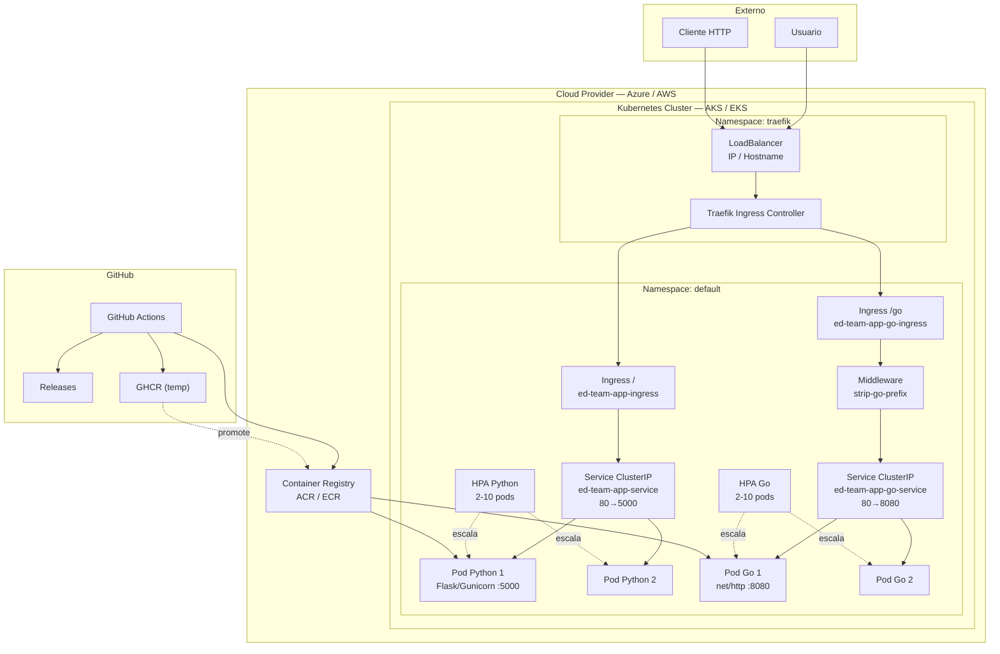
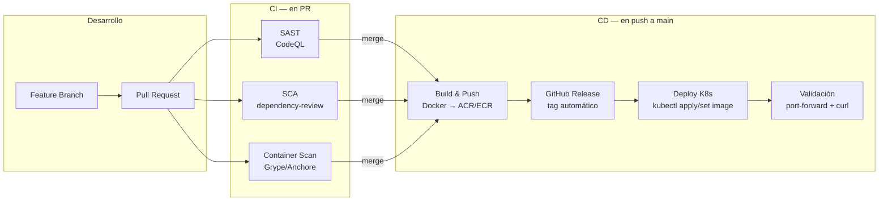
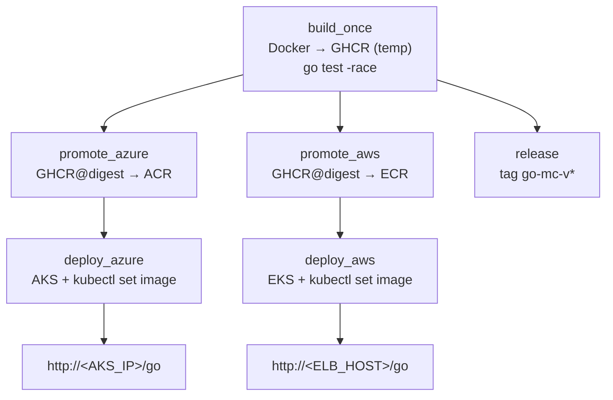
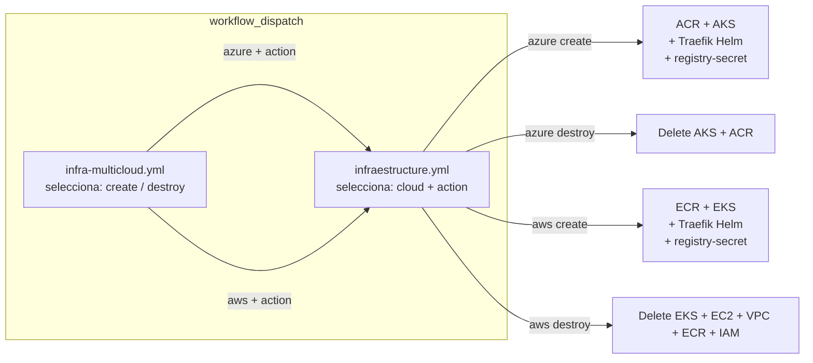

# Architecture — Reto DevSecOps ED Team

Referencia técnica completa del proyecto. Cubre aplicaciones, imágenes Docker, manifiestos Kubernetes, pipelines CI/CD y estrategia multi-cloud. Diseñada para que cualquier cambio, extensión o debug pueda realizarse leyendo solo este archivo.

---

## Tabla de contenidos

1. [Resumen del sistema](#1-resumen-del-sistema)
2. [Aplicaciones](#2-aplicaciones)
3. [Imágenes Docker](#3-imágenes-docker)
4. [Manifiestos Kubernetes](#4-manifiestos-kubernetes)
5. [Workflows CI/CD](#5-workflows-cicd)
6. [Infraestructura Cloud](#6-infraestructura-cloud)
7. [Variables y Secretos](#7-variables-y-secretos)
8. [Nomenclatura de imágenes](#8-nomenclatura-de-imágenes)
9. [Seguridad](#9-seguridad)
10. [Diagramas](#10-diagramas)
11. [Comandos de operación](#11-comandos-de-operación)

---

## 1. Resumen del sistema

El proyecto expone dos APIs idénticas en funcionalidad (Python Flask y Go) desplegadas en Kubernetes sobre Azure AKS o AWS EKS. Todo el ciclo de vida —desde el análisis de seguridad hasta el despliegue— está automatizado con GitHub Actions.

| Componente | Azure | AWS |
|------------|-------|-----|
| Container Registry | ACR (`acredteamdevsecops.azurecr.io`) | ECR (`<account>.dkr.ecr.<region>.amazonaws.com`) |
| Kubernetes | AKS | EKS |
| Ingress Controller | Traefik (namespace `traefik`, Helm, tipo `LoadBalancer`) | Traefik (mismo setup) |
| CI/CD | GitHub Actions | GitHub Actions |
| SAST | CodeQL (`security-extended`) | CodeQL (`security-extended`) |
| SCA | `dependency-review-action` (solo PRs) | `dependency-review-action` (solo PRs) |
| Container Scan | Anchore/Grype → SARIF a GitHub Security | Anchore/Grype → SARIF a GitHub Security |

El cloud destino se controla con la variable de repositorio `CLOUD_PROVIDER` (`azure` o `aws`). Los workflows leen ese valor en runtime para decidir el path de autenticación, build y deploy.

---

## 2. Aplicaciones

### 2.1 Python Flask — `src/`

| Detalle | Valor |
|---------|-------|
| Archivo principal | `src/app.py` |
| Framework | Flask 2.3.3 |
| Servidor WSGI | Gunicorn 23.0.0 |
| Puerto | `5000` (configurable vía `PORT` env var) |
| Runtime | Python 3.13 |

**Endpoints:**

| Método | Path | Response |
|--------|------|----------|
| `GET` | `/` | `{"message": "Hola ED Team"}` |
| `GET` | `/health` | `{"status": "healthy"}` |

**Dependencias (`src/requirements.txt`):**
```
Flask==2.3.3
gunicorn==23.0.0
```

**Código relevante (`src/app.py`):**
```python
from flask import Flask, jsonify
import os

app = Flask(__name__)

@app.route('/')
def hello():
    return jsonify({"message": "Hola ED Team"})

@app.route('/health')
def health():
    return jsonify({"status": "healthy"})

if __name__ == '__main__':
    port = int(os.environ.get('PORT', 5000))
    app.run(host='0.0.0.0', port=port, debug=False)
```

---

### 2.2 Go — `src-go/`

| Detalle | Valor |
|---------|-------|
| Archivo principal | `src-go/main.go` |
| Framework | `net/http` estándar |
| Puerto | `8080` (configurable vía `PORT` env var) |
| Módulo | `src-go/go.mod` |
| Runtime | Go 1.23 |

**Endpoints:**

| Método | Path | Response | Notas |
|--------|------|----------|-------|
| `GET` | `/` | `{"message": "Hola ED Team"}` | Productivo |
| `GET` | `/health` | `{"status": "healthy"}` | Productivo |
| `GET` | `/search?username=X` | `{"query": "executed"}` | **Vulnerabilidad intencional** (SQL Injection para SAST) |
| `GET` | `/exec?host=X` | `{"result": "..."}` | **Vulnerabilidad intencional** (Command Injection para SAST) |

**Vulnerabilidades intencionales en `main.go`** (para demostrar CodeQL):
- Credenciales hardcodeadas: constantes `API_KEY`, `API_SECRET`, `DB_PASSWORD`
- SQL Injection: `/search` concatena `username` directamente en la query SQL
- Command Injection: `/exec` pasa `host` directamente a `exec.Command("sh", "-c", "ping -c 1 "+host)`

Estas vulnerabilidades son detectadas por CodeQL con queries `security-extended` y los resultados aparecen en GitHub Security → Code scanning.

**Tests (`src-go/main_test.go`):**
- `TestHelloHandler` — verifica status 200 y `{"message": "Hola ED Team"}`
- `TestHealthHandler` — verifica status 200 y `{"status": "healthy"}`
- Usan `net/http/httptest` (sin dependencias externas)
- Se ejecutan con `go test -v -race ./...`

---

## 3. Imágenes Docker

### 3.1 Python — `src/Dockerfile`

```dockerfile
FROM python:3.13-slim
WORKDIR /app
COPY requirements.txt .
RUN pip install --no-cache-dir -r requirements.txt
COPY app.py .
RUN addgroup --gid 1000 appgroup && \
    adduser --uid 1000 --gid 1000 --disabled-password --gecos "" appuser
USER appuser
EXPOSE 5000
CMD ["gunicorn", "--bind", "0.0.0.0:5000", "app:app"]
```

| Aspecto | Detalle |
|---------|---------|
| Base | `python:3.13-slim` — imagen única (no multi-stage) |
| Usuario | `appuser` uid/gid 1000 — no root |
| Puerto expuesto | 5000 |
| Entrypoint | `gunicorn --bind 0.0.0.0:5000 app:app` |
| Sin pip cache | `--no-cache-dir` reduce tamaño |

---

### 3.2 Go — `src-go/Dockerfile`

```dockerfile
FROM golang:1.23-alpine AS builder
WORKDIR /app
COPY go.mod go.sum ./
RUN go mod download
COPY . .
RUN CGO_ENABLED=0 GOOS=linux go build -o server .

FROM alpine:3.20
RUN addgroup -g 1000 appgroup && \
    adduser -u 1000 -G appgroup -D appuser
WORKDIR /app
COPY --from=builder /app/server .
USER appuser
EXPOSE 8080
CMD ["./server"]
```

| Aspecto | Detalle |
|---------|---------|
| Stage 1 | `golang:1.23-alpine` — compila el binario |
| Stage 2 | `alpine:3.20` — imagen final mínima |
| CGO | Deshabilitado (`CGO_ENABLED=0`) → binario estático |
| Usuario | `appuser` uid/gid 1000 — no root |
| Puerto expuesto | 8080 |
| Binario | `./server` |

---

## 4. Manifiestos Kubernetes

Los dos sets de manifiestos son paralelos: `k8s/` para la app Python y `k8s-go/` para la app Go. Ambos se despliegan en el namespace `default`.

### 4.1 Python — `k8s/`

#### `k8s/deployment.yml`

| Campo | Valor |
|-------|-------|
| Nombre | `ed-team-app` |
| Namespace | `default` |
| Réplicas | 2 |
| Estrategia | `RollingUpdate` — `maxUnavailable: 0`, `maxSurge: 1` |
| Imagen | `ACR_LOGIN_SERVER/ed-team-app:latest` (reemplazada en deploy por la tag real) |
| Puerto del contenedor | 5000 |
| `imagePullSecrets` | `registry-secret` (creado en el paso de deploy) |
| CPU request/limit | `250m` / `500m` |
| Memoria request/limit | `64Mi` / `128Mi` |
| Liveness probe | `GET /health :5000` — `initialDelaySeconds: 30`, `periodSeconds: 10`, `failureThreshold: 3` |
| Readiness probe | `GET /health :5000` — `initialDelaySeconds: 5`, `periodSeconds: 5`, `failureThreshold: 3` |
| `runAsNonRoot` | `true`, `runAsUser: 1000` |
| `readOnlyRootFilesystem` | `true` |
| `allowPrivilegeEscalation` | `false` |
| `capabilities.drop` | `ALL` |
| `fsGroup` | 1000 |
| Volumes | `tmp-volume` → `emptyDir` montado en `/tmp` (necesario por `readOnlyRootFilesystem`) |
| Variables de entorno | `PORT=5000`, `ENVIRONMENT=production`, `APP_NAME=ed-team-app` |

#### `k8s/service.yml`

| Campo | Valor |
|-------|-------|
| Nombre | `ed-team-app-service` |
| Tipo | `ClusterIP` |
| Puerto | `80` → `targetPort: 5000` |
| Selector | `app: ed-team-app` |

#### `k8s/ingress.yml`

| Campo | Valor |
|-------|-------|
| Nombre | `ed-team-app-ingress` |
| `ingressClassName` | `traefik` |
| Entrypoints annotation | `traefik.ingress.kubernetes.io/router.entrypoints: web` |
| Regla | `path: /` `pathType: Prefix` → `ed-team-app-service:80` |
| URL pública | `http://<TRAEFIK_EXTERNAL_IP>/` |

#### `k8s/hpa.yml`

| Campo | Valor |
|-------|-------|
| Nombre | `ed-team-app-hpa` |
| Target | `deployment/ed-team-app` |
| Min réplicas | 2 |
| Max réplicas | 10 |
| CPU trigger | `averageUtilization: 70%` |
| Memoria trigger | `averageUtilization: 80%` |
| Scale down | stabilization 300s, máx 50% por 60s |
| Scale up | stabilization 60s, máx de `100%` o `+2 pods` por 60s (el mayor) |

---

### 4.2 Go — `k8s-go/`

Idéntico a `k8s/` salvo las diferencias documentadas abajo.

#### `k8s-go/deployment.yml` — diferencias respecto a Python

| Campo | Valor |
|-------|-------|
| Nombre | `ed-team-app-go` |
| Puerto del contenedor | `8080` |
| Liveness probe port | `8080` — `initialDelaySeconds: 10` (más rápido que Python porque Go arranca instantáneo) |
| Readiness probe port | `8080` |
| Variable `PORT` | `8080` |
| Variable `APP_NAME` | `ed-team-app-go` |

#### `k8s-go/service.yml`

| Campo | Valor |
|-------|-------|
| Nombre | `ed-team-app-go-service` |
| Puerto | `80` → `targetPort: 8080` |

#### `k8s-go/ingress.yml`

| Campo | Valor |
|-------|-------|
| Nombre | `ed-team-app-go-ingress` |
| Path | `/go` (Prefix) → `ed-team-app-go-service:80` |
| Middleware annotation | `traefik.ingress.kubernetes.io/router.middlewares: default-strip-go-prefix@kubernetescrd` |
| URL pública | `http://<TRAEFIK_EXTERNAL_IP>/go` |

El middleware **strip-prefix** elimina `/go` antes de que la petición llegue al contenedor, por lo que la app Go recibe la petición como `GET /` (sin el prefijo). Esto permite que ambas apps coexistan bajo el mismo LoadBalancer IP.

#### `k8s-go/middleware.yml`

```yaml
apiVersion: traefik.io/v1alpha1
kind: Middleware
metadata:
  name: strip-go-prefix
  namespace: default
spec:
  stripPrefix:
    prefixes:
      - /go
```

Referenciado por el ingress como `default-strip-go-prefix@kubernetescrd`. **Debe aplicarse antes que el ingress** (`kubectl apply -f k8s-go/middleware.yml`).

#### `k8s-go/hpa.yml`

Idéntico al de Python. Target: `deployment/ed-team-app-go`.

---

## 5. Workflows CI/CD

### 5.1 Resumen de los 7 workflows

| Archivo | Nombre | Trigger | Paths afectados |
|---------|--------|---------|-----------------|
| `ci.yml` | Pull request - CI | push/PR a `main` | `src/**` |
| `ci-go.yml` | CI - Go | push/PR a `main` | `src-go/**` |
| `cd.yml` | CD | push a `main` | todo excepto `.github/**` |
| `cd-go.yml` | CD - Go | push a `main` | `src-go/**`, `k8s-go/**` |
| `cd-go-multicloud.yml` | CD Go Multi-Cloud Manual | `workflow_dispatch` | — |
| `infraestructure.yml` | Provision Infrastructure | `workflow_dispatch` | — |
| `infra-multicloud.yml` | Infrastructure - Multi Cloud | `workflow_dispatch` | — |

---

### 5.2 `ci.yml` — CI Python

**Trigger:** push y PR a `main` cuando hay cambios en `src/`. También `workflow_dispatch`.

**Permissions:** `contents: write`, `security-events: write`, `actions: read`, `packages: read`, `pull-requests: write`

**Jobs:**

| Job | Condición | Herramienta | Detalles |
|-----|-----------|-------------|---------|
| `SAST` | siempre | CodeQL | Language: `python`, `build-mode: none`, queries: `security-extended`, sube SARIF a GitHub Security |
| `SCA` | solo PRs (`github.event_name == 'pull_request'`) | `dependency-review-action@v4` | `warn-only: true`, comenta en PR, verifica vulnerabilidades |
| `Container_security` | siempre | Anchore `scan-action@v6` | Construye imagen de `src/Dockerfile`, `fail-build: false`, `severity-cutoff: high`, sube SARIF |

---

### 5.3 `ci-go.yml` — CI Go

**Trigger:** push y PR a `main` cuando hay cambios en `src-go/`. También `workflow_dispatch`.

**Permissions:** igual que `ci.yml`.

**Jobs:**

| Job | Condición | Herramienta | Detalles |
|-----|-----------|-------------|---------|
| `test` | siempre | `go test` | `go-version: 1.23`, `cache-dependency-path: src-go/go.mod`, `go test -v -race ./...` en `src-go/` |
| `SAST` | siempre | CodeQL | Language: `go`, `build-mode: autobuild`, queries: `security-extended` |
| `SCA` | solo PRs | `dependency-review-action@v4` | igual que Python |
| `Container_security` | siempre | Anchore `scan-action@v6` | Construye imagen de `src-go/Dockerfile`, `fail-build: false`, `severity-cutoff: high` |

---

### 5.4 `cd.yml` — CD Python

**Trigger:** push a `main` (ignorando cambios en `.github/**`).

**Permissions:** `contents: write`

**Variables de entorno globales:** todas leídas de `vars.*` en GitHub — `CLOUD_PROVIDER`, `RESOURCE_GROUP`, `AKS_NAME`, `CONTAINER_NAME`, `REGISTRY_NAME`, `AWS_REGION`, `EKS_CLUSTER_NAME`, `ECR_REPOSITORY_NAME`.

**Grafo de jobs:**
```
buildImage → release → deploy → validate
```

#### Job: `buildImage`

1. Checkout del repo
2. Setup Python 3.x con cache pip
3. `pip install -r src/requirements.txt`
4. Calcula `sha_short = git rev-parse --short HEAD`
5. **Azure path:** `az login` → `az acr login` → `docker build src/Dockerfile` → `docker push` con tag `<REGISTRY_NAME>.azurecr.io/<CONTAINER_NAME>:<sha_short>`
6. **AWS path:** `configure-aws-credentials` → `ecr-login` → crea repositorio ECR si no existe → `docker build` → `docker push` con tag `<account>.dkr.ecr.<region>.amazonaws.com/<ECR_REPOSITORY_NAME>:<sha_short>`
7. Output: `image-tag` y `sha-short`

#### Job: `release`

1. Genera tag: `v$(date +'%Y%m%d')-<sha_short>`
2. `actions/create-release@v1.1.4` con `GITHUB_TOKEN`
3. El cuerpo del release incluye la imagen, commit, sha, autor y cloud provider

#### Job: `deploy` (environment: `production`)

1. Autenticación con AKS o EKS
2. Configura o recrea el secret `registry-secret` (docker-registry) en namespace `default`
   - Azure: credenciales del ACR vía `az acr credential show`
   - AWS: token temporal de ECR vía `ecr get-login-password`
3. Instala `yq` vía snap o apt
4. `yq eval` actualiza `spec.template.spec.containers[0].image` en `k8s/deployment.yml` con la tag real
5. `kubectl apply -f k8s/service.yml`
6. `kubectl apply -f k8s/deployment.yml`
7. `kubectl rollout status deployment/ed-team-app --timeout=600s`
8. `kubectl apply -f k8s/hpa.yml`
9. `kubectl apply -f k8s/ingress.yml`

#### Job: `validate`

1. Reautenticación con el cluster
2. `kubectl wait --for=condition=ready pod -l app=ed-team-app --timeout=300s`
3. `kubectl port-forward service/ed-team-app-service 8080:80` en background
4. `curl http://localhost:8080/health` — falla el job si no responde con `"healthy"`
5. Obtiene el IP/hostname externo del LoadBalancer de Traefik (intenta IP primero para Azure, hostname para AWS)

---

### 5.5 `cd-go.yml` — CD Go

**Trigger:** push a `main` cuando hay cambios en `src-go/**` o `k8s-go/**`.

Estructura idéntica al `cd.yml` Python con estas diferencias:

| Diferencia | Detalle |
|------------|---------|
| Build step extra | Ejecuta `go test -v -race ./...` antes del build Docker |
| Dockerfile | `src-go/Dockerfile` |
| Imagen Azure | `<REGISTRY_NAME>.azurecr.io/<CONTAINER_NAME>-go:<sha_short>` |
| Imagen AWS | `<account>.dkr.ecr.<region>.amazonaws.com/<ECR_REPOSITORY_NAME>-go:<sha_short>` |
| Release tag | `go-v$(date +'%Y%m%d')-<sha_short>` |
| Manifiestos | `k8s-go/` (aplica en orden: service, deployment, rollout, hpa, ingress) |
| Deployment name | `ed-team-app-go` |
| Actualización de imagen | `yq` sobre `k8s-go/deployment.yml` |

---

### 5.6 `cd-go-multicloud.yml` — CD Go Multi-Cloud (manual)

**Trigger:** `workflow_dispatch` — ejecución manual exclusivamente.

**Concepto clave:** construye la imagen Docker **una única vez** en GHCR y la promueve (pull + retag + push) a los dos registries en paralelo, garantizando que la imagen en ACR y ECR es binariamente idéntica.

**Grafo de jobs:**
```
build_once
├── promote_azure  → deploy_azure (AKS)
├── promote_aws    → deploy_aws   (EKS)
└── release
```
Los jobs `promote_azure`, `promote_aws` y `release` corren en paralelo (todos dependen solo de `build_once`). Los deploys esperan a sus respectivas promociones y al release.

#### Job: `build_once` (outputs: `short-sha`, `ghcr-owner-lc`, `ghcr-tag`, `ghcr-image`, `ghcr-digest`)

1. Checkout + setup Go 1.23
2. `go test -v -race ./...`
3. `short_sha = git rev-parse --short HEAD`
4. `owner_lc = lowercase(GITHUB_REPOSITORY_OWNER)` (necesario porque GHCR es case-sensitive)
5. Tag GHCR: `mc-<run_id>-<short_sha>`
6. Image GHCR: `ghcr.io/<owner_lc>/ed-team-app-go-multicloud`
7. `docker/setup-buildx-action@v3`
8. Login a GHCR con `GITHUB_TOKEN`
9. `docker/build-push-action@v6` con `provenance: false` — push con digest
10. Output incluye el digest SHA256 de la imagen

#### Job: `promote_azure` (depende de `build_once`)

1. Login Azure + login GHCR + `az acr login`
2. `docker pull ghcr.io/<owner>/<image>@<digest>` (por digest, no por tag, garantiza integridad)
3. `docker tag` → `<REGISTRY_NAME>.azurecr.io/<CONTAINER_NAME>-go:<short_sha>`
4. `docker push` al ACR

#### Job: `promote_aws` (depende de `build_once`)

1. Configure AWS credentials + login GHCR + `ecr-login`
2. Crea repo ECR si no existe
3. Pull por digest desde GHCR, retag, push a ECR

#### Job: `release` (depende de `build_once`)

Tag: `go-mc-v$(date +'%Y%m%d')-<short_sha>`

#### Job: `deploy_azure` (depende de `promote_azure` + `release`)

1. Login Azure, set AKS context
2. Crea/actualiza `registry-secret` con credenciales de ACR
3. `kubectl apply -f k8s-go/middleware.yml` (strip-prefix)
4. `kubectl apply -f k8s-go/service.yml`
5. `kubectl apply -f k8s-go/deployment.yml`
6. `kubectl set image deployment/ed-team-app-go ed-team-app-go=<azure-image>` (no usa yq, usa `set image`)
7. `kubectl rollout status --timeout=600s`
8. `kubectl apply -f k8s-go/hpa.yml` + `ingress.yml`
9. Obtiene external IP del LoadBalancer; expone `app_url=http://<ip>/go` y `health_url=http://<ip>/go/health`

#### Job: `deploy_aws` (depende de `promote_aws` + `release`)

Mismo flujo pero con EKS. Para AWS el LoadBalancer devuelve hostname en vez de IP — el job espera hasta 30 intentos (con sleep entre intentos) hasta que el hostname sea resolvible via DNS antes de publicar la URL.

---

### 5.7 `infraestructure.yml` — Provision Infrastructure (manual)

**Trigger:** `workflow_dispatch` con inputs:
- `cloud_provider`: `azure` | `aws` (default: `azure`)
- `action`: `create` | `destroy` (default: `create`)

**Jobs condicionales** (solo corre el que corresponde al input):

| Job | Condición |
|-----|-----------|
| `azure-create` | `cloud_provider == azure && action == create` |
| `azure-destroy` | `cloud_provider == azure && action == destroy` |
| `aws-create` | `cloud_provider == aws && action == create` |
| `aws-destroy` | `cloud_provider == aws && action == destroy` |

#### `azure-create` — lo que crea:

1. Verifica que el Resource Group **ya existe** (no lo crea — debe existir previamente)
2. **ACR:** `az acr create --sku Basic --admin-enabled true --name acredteamdevsecops`
3. **AKS:** `az aks create --node-count 1 --node-vm-size Standard_D2s_v3 --enable-managed-identity --generate-ssh-keys`
4. Obtiene credenciales: `az aks get-credentials`
5. Crea/actualiza `registry-secret` en Kubernetes con credenciales del ACR
6. **Traefik:** instala Helm si no está, `helm repo add traefik`, `helm install traefik traefik/traefik --namespace traefik --create-namespace --set service.type=LoadBalancer`
7. Espera readiness del pod de Traefik (`--timeout=300s`)
8. Genera summary: lista ACR, nodos del cluster, pods de Traefik, IP del LoadBalancer

#### `aws-create` — lo que crea:

1. Configura credenciales AWS
2. **ECR:** crea repositorio si no existe
3. **EKS:** creación por AWS CLI pura (`aws eks create-cluster`) + worker node EC2 autogestionado
4. Obtiene kubeconfig: `aws eks update-kubeconfig`
5. Crea `registry-secret` con token ECR temporal
6. Traefik vía Helm (igual que Azure)

#### Destroys:

Eliminan todos los recursos creados en orden inverso (Traefik → cluster → registry).

---

### 5.8 `infra-multicloud.yml` — Infrastructure Multi-Cloud (manual)

**Trigger:** `workflow_dispatch` con un solo input:
- `action`: `create` | `destroy`

Dispara `infraestructure.yml` dos veces en paralelo (por `gh workflow run`):
- Con `cloud_provider=azure` y `action=<input>`
- Con `cloud_provider=aws` y `action=<input>`

Requiere permiso `actions: write` para poder disparar otros workflows.

---

## 6. Infraestructura Cloud

### 6.1 Azure

| Recurso | Valor |
|---------|-------|
| Resource Group | variable `RESOURCE_GROUP` (debe existir, no se crea automáticamente) |
| ACR Name | `acredteamdevsecops` (hardcodeado en el workflow de infra) |
| ACR SKU | `Basic` |
| ACR Admin | habilitado (necesario para obtener usuario/contraseña del secret) |
| AKS node size | `Standard_D2s_v3` |
| AKS node count | 1 |
| AKS auth | Managed Identity |
| Traefik namespace | `traefik` |
| Traefik service | `LoadBalancer` — IP pública asignada por Azure |
| Registry secret | `registry-secret` en namespace `default` — credenciales del ACR |

**Autenticación del workflow:** Service Principal vía secret `AZURE_CREDENTIALS` (JSON con `clientId`, `clientSecret`, `subscriptionId`, `tenantId`).

### 6.2 AWS

| Recurso | Valor |
|---------|-------|
| ECR Repository | variable `ECR_REPOSITORY_NAME` |
| EKS Cluster | variable `EKS_CLUSTER_NAME` |
| Región | variable `AWS_REGION` |
| Traefik service | `LoadBalancer` — hostname DNS de ELB (no IP) |
| Registry secret | `registry-secret` en namespace `default` — token temporal de ECR (`aws ecr get-login-password`) |

**Nota importante para AWS:** el token de ECR expira cada 12 horas. El CD lo recrea en cada deploy con `--dry-run=client -o yaml | kubectl apply -f -` (idempotente).

**Autenticación del workflow:** IAM con `AWS_ACCESS_KEY_ID` + `AWS_SECRET_ACCESS_KEY`.

### 6.3 Traefik

Traefik es el único ingress controller usado. Se instala en ambos clouds con los mismos parámetros de Helm.

- Namespace: `traefik`
- Chart: `traefik/traefik` (repo oficial)
- Service type: `LoadBalancer`
- Entrypoint activo: `web` (HTTP, puerto 80)
- Las apps se registran con `ingressClassName: traefik` y la annotation `traefik.ingress.kubernetes.io/router.entrypoints: web`

Routing por path en el mismo LoadBalancer:
- `/` → Python app (`ed-team-app-service:80`)
- `/go` → Go app (`ed-team-app-go-service:80`) + middleware `strip-go-prefix` que elimina `/go`

---

## 7. Variables y Secretos

### Secrets (GitHub → Settings → Secrets → Actions)

| Secret | Proveedor | Cuándo se usa |
|--------|-----------|---------------|
| `AZURE_CREDENTIALS` | Azure | Todos los workflows que tocan Azure |
| `AWS_ACCESS_KEY_ID` | AWS | Todos los workflows que tocan AWS |
| `AWS_SECRET_ACCESS_KEY` | AWS | Todos los workflows que tocan AWS |
| `GITHUB_TOKEN` | GitHub (automático) | Release, SARIF upload, GHCR |

Formato de `AZURE_CREDENTIALS`:
```json
{
  "clientId": "xxxxxxxx-xxxx-xxxx-xxxx-xxxxxxxxxxxx",
  "clientSecret": "xxxxxxxxxxxxxxxxxxxxxxxxxxxxxxxx",
  "subscriptionId": "xxxxxxxx-xxxx-xxxx-xxxx-xxxxxxxxxxxx",
  "tenantId": "xxxxxxxx-xxxx-xxxx-xxxx-xxxxxxxxxxxx"
}
```
Ver ejemplo en `doc/azure-credentials-example.json`.

### Variables de repositorio (GitHub → Settings → Variables → Actions)

| Variable | Proveedor | Descripción | Ejemplo |
|----------|-----------|-------------|---------|
| `CLOUD_PROVIDER` | ambos | Determina el path en CI/CD | `azure` o `aws` |
| `RESOURCE_GROUP` | Azure | Resource Group existente | `rg-edteam-devsecops` |
| `AKS_NAME` | Azure | Nombre del cluster | `aks-edteam-cluster` |
| `CONTAINER_NAME` | Azure | Nombre base de imagen | `ed-team-app` |
| `REGISTRY_NAME` | Azure | Nombre del ACR (sin `.azurecr.io`) | `acredteamdevsecops` |
| `AZURE_LOCATION` | Azure | Región | `eastus` |
| `AWS_REGION` | AWS | Región | `us-east-1` |
| `EKS_CLUSTER_NAME` | AWS | Nombre del cluster | `eks-ed-team-cluster` |
| `ECR_REPOSITORY_NAME` | AWS | Nombre del repositorio ECR | `ed-team-app` |

Ejemplos completos en `doc/azure-variables-example.json` y `doc/aws-variables-example.json`.

### Environments de GitHub (GitHub -> Settings -> Environments)

Environments esperados:
- `production`
- `desarrollo`

Uso real en workflows:
- `production` se usa en los jobs `deploy` de `.github/workflows/cd.yml` y `.github/workflows/cd-go.yml`.
- `desarrollo` existe como entorno de extensibilidad para un flujo futuro de preproducción.

Configuración recomendada para `production`:
1. Deployment branches: solo `main`.
2. Required reviewers: al menos 1.
3. Wait timer opcional: 5-10 minutos.
4. Environment secrets: no obligatorios actualmente.

Guia operativa completa y checklist final:
- `doc/github-actions-setup.md`

---

## 8. Nomenclatura de imágenes

| App | Cloud | Formato | Ejemplo |
|-----|-------|---------|---------|
| Python | Azure | `<REGISTRY_NAME>.azurecr.io/<CONTAINER_NAME>:<sha_short>` | `acredteamdevsecops.azurecr.io/ed-team-app:a1b2c3d` |
| Python | AWS | `<account>.dkr.ecr.<region>.amazonaws.com/<ECR_REPOSITORY_NAME>:<sha_short>` | `123456789.dkr.ecr.us-east-1.amazonaws.com/ed-team-app:a1b2c3d` |
| Go | Azure | `<REGISTRY_NAME>.azurecr.io/<CONTAINER_NAME>-go:<sha_short>` | `acredteamdevsecops.azurecr.io/ed-team-app-go:a1b2c3d` |
| Go | AWS | `<account>.dkr.ecr.<region>.amazonaws.com/<ECR_REPOSITORY_NAME>-go:<sha_short>` | `123456789.dkr.ecr.us-east-1.amazonaws.com/ed-team-app-go:a1b2c3d` |
| Go MultiCloud (temp GHCR) | GitHub | `ghcr.io/<owner_lc>/ed-team-app-go-multicloud:mc-<run_id>-<sha_short>` | `ghcr.io/yemboy/ed-team-app-go-multicloud:mc-123456-a1b2c3d` |

**Release tags:**
- Python CD: `v<YYYYMMDD>-<sha_short>` (ej: `v20260313-a1b2c3d`)
- Go CD: `go-v<YYYYMMDD>-<sha_short>` (ej: `go-v20260313-a1b2c3d`)
- Go MultiCloud: `go-mc-v<YYYYMMDD>-<sha_short>` (ej: `go-mc-v20260313-a1b2c3d`)

---

## 9. Seguridad

### Controles implementados

| Control | Herramienta | Alcance |
|---------|-------------|---------|
| SAST | CodeQL (`security-extended`) | Python y Go, en push y PR |
| SCA | `dependency-review-action` | Python y Go, solo en PRs |
| Container scanning | Anchore/Grype | Python y Go, en push y PR — result SARIF en GitHub Security |
| Non-root containers | `runAsUser: 1000`, `runAsNonRoot: true` | Ambas apps en K8s |
| Read-only filesystem | `readOnlyRootFilesystem: true` | Ambas apps (con `/tmp` como `emptyDir`) |
| Sin escalada de privilegios | `allowPrivilegeEscalation: false` | Ambas apps |
| Sin capabilities | `capabilities.drop: [ALL]` | Ambas apps |
| Resource limits | CPU y memoria definidos | Ambas apps |
| Registry secret | K8s secret `docker-registry` | Pull privado desde ACR/ECR |
| Imagen por digest | En MultiCloud promote | Garantiza integridad entre GHCR → ACR/ECR |

### Vulnerabilidades intencionales en `src-go/main.go`

Estas vulnerabilidades **existen a propósito** para demostrar la detección de CodeQL. No afectan los endpoints productivos (`/` y `/health`).

| Tipo | Ubicación | CWE |
|------|-----------|-----|
| Credenciales hardcodeadas | Constantes `API_KEY`, `API_SECRET`, `DB_PASSWORD` | CWE-798 |
| SQL Injection | Handler `/search` — concatenación directa en query | CWE-89 |
| Command Injection | Handler `/exec` — `exec.Command("sh", "-c", "ping -c 1 "+host)` | CWE-78 |

CodeQL con queries `security-extended` detecta los tres y los reporta en **GitHub → Security → Code scanning alerts**.

### Comportamiento del Container Scan

- `fail-build: false` → el pipeline no se rompe si hay vulnerabilidades (permite iterar)
- `severity-cutoff: high` → solo reporta HIGH y CRITICAL
- Los resultados se suben a SARIF y aparecen en GitHub Security → Code scanning

---

## 10. Diagramas

### Arquitectura en Kubernetes (ambas apps)



### Flujo CI/CD



### CD Go Multi-Cloud (build único)



### Infraestructura — provisioning manual



---

## 11. Comandos de operación

### Obtener acceso al cluster

```bash
# Azure
az aks get-credentials --resource-group $RESOURCE_GROUP --name $AKS_NAME

# AWS
aws eks update-kubeconfig --name $EKS_CLUSTER_NAME --region $AWS_REGION
```

### Verificar estado de las apps

```bash
# Pods
kubectl get pods -n default -l app=ed-team-app        # Python
kubectl get pods -n default -l app=ed-team-app-go     # Go

# HPA
kubectl get hpa -n default

# Ingress
kubectl get ingress -n default

# Traefik LoadBalancer (IP pública)
kubectl get service -n traefik traefik
```

### Probar los endpoints

```bash
# Python (ruta raíz del LoadBalancer)
curl http://<TRAEFIK_IP>/
curl http://<TRAEFIK_IP>/health

# Go (ruta /go — el middleware quita /go antes de llegar al contenedor)
curl http://<TRAEFIK_IP>/go
curl http://<TRAEFIK_IP>/go/health
```

### Aplicar manifiestos manualmente

```bash
# Python
kubectl apply -f k8s/service.yml
kubectl apply -f k8s/deployment.yml
kubectl rollout status deployment/ed-team-app
kubectl apply -f k8s/hpa.yml
kubectl apply -f k8s/ingress.yml

# Go (el middleware DEBE aplicarse primero)
kubectl apply -f k8s-go/middleware.yml
kubectl apply -f k8s-go/service.yml
kubectl apply -f k8s-go/deployment.yml
kubectl rollout status deployment/ed-team-app-go
kubectl apply -f k8s-go/hpa.yml
kubectl apply -f k8s-go/ingress.yml
```

### Actualizar imagen manualmente

```bash
# Python
kubectl set image deployment/ed-team-app ed-team-app=<IMAGE_TAG>

# Go
kubectl set image deployment/ed-team-app-go ed-team-app-go=<IMAGE_TAG>

# Verificar rollout
kubectl rollout status deployment/ed-team-app --timeout=600s
```

### Debug

```bash
# Logs de un pod
kubectl logs -n default -l app=ed-team-app --tail=100
kubectl logs -n default -l app=ed-team-app-go --tail=100

# Port-forward para probar sin LoadBalancer
kubectl port-forward service/ed-team-app-service 8080:80
kubectl port-forward service/ed-team-app-go-service 8081:80

# Describir deployment tras un fallo de rollout
kubectl describe deployment ed-team-app
kubectl describe deployment ed-team-app-go

# Eventos del namespace
kubectl get events -n default --sort-by='.lastTimestamp'
```

### Ejecutar tests Go localmente

```bash
cd src-go
go test -v -race ./...
```

### Construir y probar imágenes localmente

```bash
# Python
docker build -t ed-team-app src/
docker run -p 5000:5000 ed-team-app
curl http://localhost:5000/health

# Go
docker build -t ed-team-app-go src-go/
docker run -p 8080:8080 ed-team-app-go
curl http://localhost:8080/health
```
